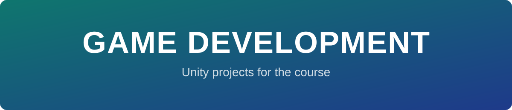
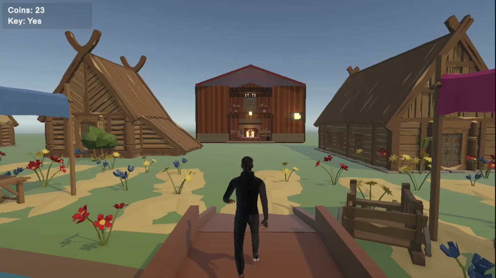
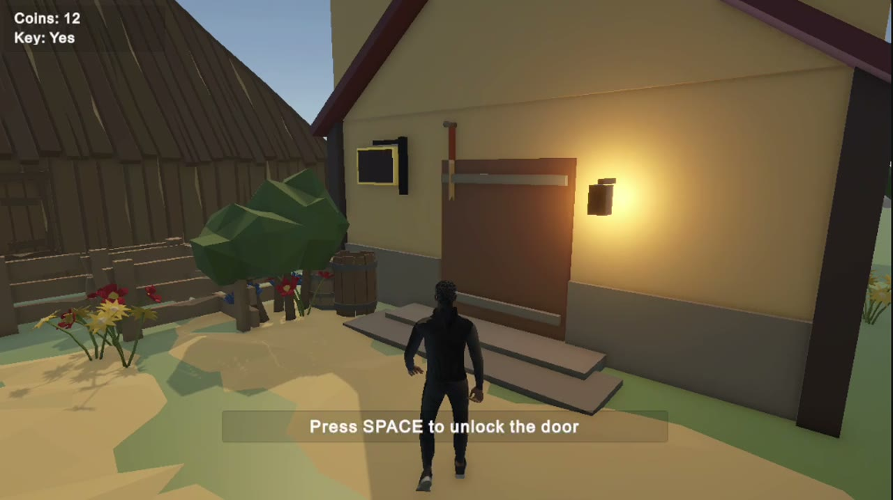
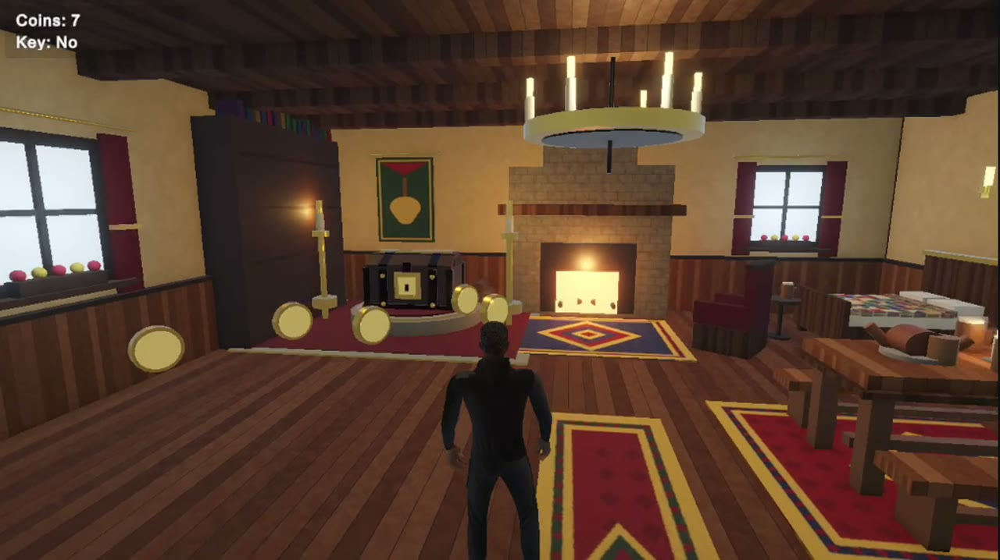

  
  
  

<b>Unity projects built for the Game Development course.</b>

---

## 📚 Projects

| Project | Description |
|---|---|
| 🏘️ [`FairytaleVillage/`](FairytaleVillage) | A fairytale village on two banks of a river: houses, paths, a pub, a bridge and market stalls, plus a playable character, coins, keys and interiors. |
| 🏦 [**bank-heist**](https://github.com/ofekfanian/bank-heist) | The final project, in its own repository. |

## 📸 FairytaleVillage

<table>
  <tr>
    <td colspan="2"> The village and its market stalls</td>
  </tr>
  <tr>
    <td> Collect a key and unlock the door</td>
    <td> Inside a house</td>
  </tr>
</table>

🎥 Submission video: [`videos/Task3.mp4`](videos/Task3.mp4)

## 🛠️ Rebuilding the village

The village is generated by an editor script, so it can be rebuilt at any time:

1. Open `FairytaleVillage/` in Unity Hub (Unity 6000.5.7f1).
2. Choose **Tools ▸ Fairytale Village ▸ Build** (or **Clear**).

The generator is [`Assets/Editor/VillageBuilder.cs`](FairytaleVillage/Assets/Editor/VillageBuilder.cs).

## 📦 Not included

To keep the repository small, the following are left out:

- `Library/`, `Logs/`, `Temp/`, `UserSettings/` – Unity regenerates them when the project opens
- Raw screen recordings
- Asset files larger than 20 MB (Mixamo `.fbx` characters/animations) – download them again from [Mixamo](https://www.mixamo.com) into `Assets/Mixamo/`
